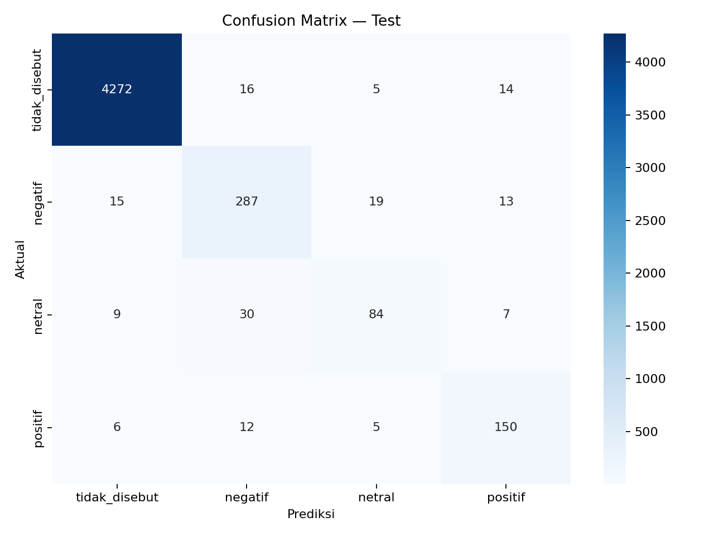

# ReviewScope ABSA

[](https://github.com/SultanShalahuddin/shopee-absa-app/actions/workflows/ci.yml)

ReviewScope adalah aplikasi **Aspect-Based Sentiment Analysis (ABSA)** untuk
menganalisis ulasan pengguna Shopee berbahasa Indonesia. Satu ulasan dievaluasi
terhadap delapan aspek layanan, lalu setiap aspek diklasifikasikan sebagai
`tidak_disebut`, `negatif`, `netral`, atau `positif`.

> Contoh: “Aplikasinya cepat, tetapi kurirnya lambat dan voucher tidak bisa
> dipakai.” menghasilkan `positif` untuk performa aplikasi serta `negatif`
> untuk pengiriman dan promo.

[Lihat presentasi studi kasus](https://docs.google.com/presentation/d/1Yt9WnoOAGz-aDBIiX_y2gcuPKWteK093/edit?usp=sharing)

**Production:** [Aplikasi ReviewScope](https://reviewscope-absa-app.vercel.app) ·
[API health](https://reviewscope-absa-api.vercel.app/health) ·
[Repository GitHub](https://github.com/SultanShalahuddin/shopee-absa-app)

## Latar belakang

Shopee memiliki lebih dari 18 juta ulasan dan rating di Google Play Store.
Rating bintang memberi gambaran umum, tetapi tidak menjelaskan bagian produk
yang disukai atau dikeluhkan pengguna. Analisis manual pada skala tersebut juga
tidak praktis.

Project ini bertujuan untuk:

- menemukan aspek yang disebut dalam setiap ulasan;
- menentukan sentimen pada masing-masing aspek;
- membantu tim produk memprioritaskan perbaikan berdasarkan isu yang spesifik;
- menyediakan aplikasi web yang menyimpan riwayat analisis untuk evaluasi lebih
  lanjut.

## Fitur utama

- Menganalisis delapan aspek sekaligus dalam satu request.
- Menampilkan label sentimen dan confidence untuk setiap aspek.
- Menyimpan satu review dan delapan hasil aspek ke Supabase.
- Menampilkan riwayat analisis pada antarmuka Next.js.
- Menggunakan model IndoBERT dynamic INT8 melalui ONNX Runtime CPU.
- Menghentikan startup production jika model asli tidak tersedia; tidak ada
  fallback prediksi palsu secara diam-diam.

Delapan aspek yang digunakan adalah:

1. Iklan dan konten
2. Pengiriman dan kurir
3. Performa aplikasi
4. Akun, login, dan keamanan
5. Pembayaran, COD, dan keuangan
6. Promo, voucher, harga, dan biaya
7. Penjual dan kualitas produk
8. Retur, refund, dan layanan

## Data dan preprocessing

Dataset awal berisi **10.000 ulasan** aplikasi `com.shopee.id` dari Google Play
Store, diambil pada rentang **17 Agustus–4 September 2026** menggunakan
`google-play-scraper`.

| Tahap | Jumlah review | Keterangan |
|---|---:|---|
| Data awal | 10.000 | Hasil scraping |
| Hapus duplikat | 7.796 | 2.204 konten duplikat dihapus |
| Filter review pendek | 6.685 | Review kurang dari tiga kata dihapus |
| Normalisasi dan filter bahasa | 6.176 | Normalisasi ringan/slang dan seleksi bahasa Indonesia |

Data kemudian dibagi berdasarkan `reviewId` sebelum diubah menjadi format
review–aspek. Dengan cara ini, review yang sama tidak muncul pada lebih dari
satu subset.

| Subset | Review | Pasangan review–aspek |
|---|---:|---:|
| Train | 4.940 (80%) | 39.520 |
| Validation | 618 (10%) | 4.944 |
| Test | 618 (10%) | 4.944 |

Pelabelan dilakukan melalui eksplorasi topik BERTopic, kalibrasi manual pada
200 ulasan, pelabelan berbantuan GPT menggunakan aturan hasil kalibrasi, lalu
validasi format. Total dataset berisi **49.408 pasangan review–aspek**. Sebanyak
87,1% berlabel `tidak_disebut`, sehingga training menggunakan class weighting.

## Model dan training

Model dasar yang digunakan adalah
[`indobenchmark/indobert-base-p2`](https://huggingface.co/indobenchmark/indobert-base-p2)
dengan kepala klasifikasi empat kelas. Input model berupa pasangan teks
`(review, prompt_aspek)`. Delapan pasangan dari satu review diproses sebagai
satu batch inference.

Konfigurasi training utama:

| Parameter | Nilai |
|---|---:|
| Maximum sequence length | 128 token |
| Train batch size | 16 |
| Gradient accumulation | 2 |
| Effective batch size | 32 |
| Epoch maksimum | 4 |
| Precision | FP16 |
| Warmup | 10% steps |
| Seed | 42 |
| Loss | Weighted cross entropy |

Empat eksperimen dijalankan dengan split, seed, dan batas epoch yang sama.
Model dipilih berdasarkan validation macro F1, bukan accuracy, karena distribusi
kelas sangat tidak seimbang.

| Trial | Learning rate | Weight decay | Class weight | Validation macro F1 |
|---|---:|---:|---|---:|
| `baseline` | 2e-5 | 0,01 | balanced | 0,813911 |
| `lr_1e-5` | 1e-5 | 0,01 | balanced | 0,809171 |
| `wd_0-05` | 2e-5 | 0,05 | balanced | 0,800835 |
| **`sqrt_weight`** | **2e-5** | **0,01** | **sqrt** | **0,826657** |

## Evaluasi model final

Evaluasi hanya dilakukan satu kali pada test set berisi 618 review atau 4.944
pasangan review–aspek yang tidak digunakan saat tuning.

| Metric test | PyTorch FP32 | ONNX INT8 |
|---|---:|---:|
| Accuracy | 96,95% | 96,93% |
| Macro F1 | 84,24% | 84,07% |
| Weighted F1 | 96,93% | 96,91% |
| Aspect-detection F1 | 94,92% | 94,99% |
| Sentiment-mentioned F1 | 81,54% | 81,28% |

Hasil FP32 per kelas:

| Label | F1 | Support |
|---|---:|---:|
| `tidak_disebut` | 0,992 | 4.307 |
| `negatif` | 0,845 | 334 |
| `netral` | 0,691 | 130 |
| `positif` | 0,840 | 173 |



Macro F1 model referensi per aspek:

| Aspek | Macro F1 |
|---|---:|
| Performa aplikasi | 0,882 |
| Retur, refund, dan layanan | 0,830 |
| Promo, voucher, harga, dan biaya | 0,822 |
| Pengiriman dan kurir | 0,788 |
| Akun, login, dan keamanan | 0,746 |
| Pembayaran, COD, dan keuangan | 0,741 |
| Iklan dan konten | 0,683 |
| Penjual dan kualitas produk | 0,608 |

Kelas `netral` masih menjadi kelas tersulit. Aspek penjual/kualitas produk serta
iklan/konten juga menjadi prioritas audit label dan penambahan data.

## Migrasi ONNX INT8

Model final diekspor ke FP32 ONNX, diverifikasi terhadap PyTorch, lalu
dikuantisasi secara dinamis ke INT8 untuk inference CPU.

- FP32 ONNX menghasilkan label yang sama 100% dengan PyTorch pada golden test.
- INT8 mempertahankan 99,8786% kesamaan prediksi dengan golden test.
- Penurunan macro F1 hanya 0,001640, masih di bawah batas 0,005.
- Penurunan macro F1 per aspek terbesar adalah 0,007292, masih di bawah batas
  investigasi 0,01.
- Ukuran model turun dari 474,740 MiB menjadi 230,897 MiB.
- Estimasi inference lokal turun dari 288,025 ms menjadi 131,619 ms per review
  delapan aspek pada batch evaluasi.

Seluruh quality gate yang ditetapkan untuk model INT8 telah lulus. Laporan
reproduksi tersedia di
[`research/artifacts/onnx-int8-evaluation/`](research/artifacts/onnx-int8-evaluation/).

## Arsitektur aplikasi

```text
Browser
  └─ Next.js frontend — Vercel Hobby
       └─ FastAPI backend — Vercel Python Function
            ├─ ONNX Runtime CPU + IndoBERT INT8
            ├─ Supabase Free — penyimpanan hasil
            └─ Private Hugging Face repo — model diunduh saat build
```

| Komponen | Teknologi |
|---|---|
| Frontend | Next.js 15, React 19, TypeScript |
| Backend | FastAPI, Pydantic, HTTPX |
| Inference | ONNX Runtime CPU, `tokenizers`, NumPy |
| Database | Supabase PostgreSQL |
| Model storage | Private Hugging Face model repository |
| Deployment | Vercel Hobby (frontend dan Python Function terpisah) |

Deployment production:

- Frontend: [`reviewscope-absa-app.vercel.app`](https://reviewscope-absa-app.vercel.app)
- Backend API: [`reviewscope-absa-api.vercel.app`](https://reviewscope-absa-api.vercel.app)
- Health check: [`/health`](https://reviewscope-absa-api.vercel.app/health)

Bundle Python Function production berukuran 286,98 MB dan dijalankan sebagai
Vercel Large Function pada Fluid Compute. Pengujian prediction production
mencatat latency 250 ms untuk satu review berisi delapan aspek serta berhasil
menyimpan satu review dan delapan prediction rows ke Supabase.

Model deployment dipatok ke revision Hugging Face
`4230a98d3bf26a3c154b57b76c1827d604dc285d` dan diverifikasi menggunakan
SHA-256 sebelum backend dibangun. Token Hugging Face dan Supabase hanya boleh
berada pada environment server-side.

## Struktur repository

```text
backend/        FastAPI, ONNX inference, validasi model, dan integrasi Supabase
frontend/       Antarmuka Next.js
supabase/       Skema database
research/       Dataset terkurasi, notebook, visualisasi, dan laporan evaluasi
docs/           Catatan handoff teknis dan keputusan arsitektur
```

Bobot model, file `.env`, virtual environment, hasil build, dan folder impor
asli tidak disimpan di Git.

## Menjalankan project secara lokal

### 1. Backend

```powershell
cd backend
python -m venv .venv
.\.venv\Scripts\Activate.ps1
pip install -r requirements.txt
Copy-Item .env.example .env
```

Isi `.env` dengan konfigurasi model dan Supabase. Nilai minimum untuk model:

```dotenv
MODEL_ID=sultan028/reviewscope-absa-int8
MODEL_REVISION=4230a98d3bf26a3c154b57b76c1827d604dc285d
MODEL_SHA256=bc9668f83d7e40bc96feb79a5fd39c4bc2a8b07b618b26b63d529fe41fca3086
HF_TOKEN=<token-read-only>
ALLOW_DEMO_MODE=false
```

Unduh dan verifikasi model, jalankan smoke test, lalu mulai API:

```powershell
python -m scripts.download_model
python -m scripts.verify_model model
python -m scripts.smoke_test
uvicorn app.main:app --reload --port 8000
```

Dokumentasi interaktif API tersedia di `http://localhost:8000/docs`.

### 2. Frontend

```powershell
cd frontend
npm.cmd install
Copy-Item .env.example .env.local
npm.cmd run dev
```

Pastikan `.env.local` berisi:

```dotenv
NEXT_PUBLIC_API_URL=http://localhost:8000
```

Buka `http://localhost:3000`.

## API

| Method | Endpoint | Fungsi |
|---|---|---|
| `GET` | `/health` | Status model dan konfigurasi database |
| `POST` | `/api/v1/predict` | Prediksi delapan aspek dan simpan hasil |
| `GET` | `/api/v1/history?limit=8` | Ambil riwayat analisis |

Contoh request:

```powershell
$body = @{ review_text = 'Aplikasinya cepat, tetapi iklannya mengganggu.' } | ConvertTo-Json
Invoke-RestMethod -Method Post -Uri http://localhost:8000/api/v1/predict `
  -ContentType 'application/json' -Body $body
```

## Validasi dan reproduksi

```powershell
# Backend runtime
cd backend
python -m scripts.verify_model model
python -m scripts.verify_tokenizer_parity
python -m scripts.smoke_test
python -m scripts.benchmark_runtime

# Pipeline konversi/evaluasi ONNX (dependency tooling terpisah)
pip install -r requirements-onnx.txt
python -m scripts.onnx_pipeline

# Frontend
cd ..\frontend
npm.cmd run lint
npm.cmd run build
```

Dataset terkurasi, golden test manifest, notebook, dan laporan metrik disimpan
di `research/`. Detail kontrak model, acceptance gate, dan deployment checklist
tersedia di [`docs/PROJECT_HANDOFF.md`](docs/PROJECT_HANDOFF.md).

## CI/CD

- **Continuous Integration:** GitHub Actions menjalankan pemeriksaan dependency,
  syntax/import backend, type-check frontend, dan production build pada setiap
  push atau pull request ke `main`.
- **Continuous Deployment:** integrasi GitHub–Vercel membuat deployment otomatis
  dari branch `main`. Workflow CI tidak menyimpan secret dan tidak menjalankan
  deployment kedua melalui Vercel CLI.

Workflow tersedia di [`.github/workflows/ci.yml`](.github/workflows/ci.yml).

## Status deployment

- [x] Tuning dan evaluasi IndoBERT FP32
- [x] Export FP32 ONNX dan parity test
- [x] Quantization INT8 dan evaluasi pada golden test
- [x] Migrasi backend ke ONNX Runtime
- [x] Upload model INT8 ke private Hugging Face repository
- [x] Smoke test backend dan build frontend lokal
- [x] Source code dan dokumentasi tersedia di GitHub
- [x] GitHub Actions CI dikonfigurasi untuk backend dan frontend
- [x] Deploy backend dan frontend ke Vercel
- [x] Verifikasi model production, bundle, Supabase, dan CORS
- [x] Uji prediction production menggunakan model ONNX INT8 asli

## Rekomendasi pengembangan

1. Tambah dan tinjau ulang sampel `netral`, khususnya kasus yang berdekatan
   dengan sentimen negatif.
2. Audit label pada aspek penjual/kualitas produk serta iklan/konten.
3. Arahkan prediksi berkeyakinan rendah ke human review.
4. Pantau distribusi label, macro F1, latency, dan perubahan bahasa ulasan
   setelah deployment.

---

Dikembangkan oleh **Sultan Shalahuddin** sebagai studi kasus machine learning
untuk analisis ulasan aplikasi e-commerce.
